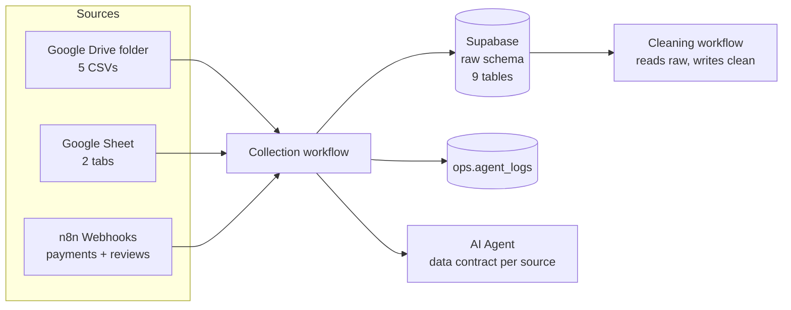

# Collection workflow: sources, n8n setup and things to watch

This guide covers how the nine messy Olist datasets reach Supabase through the n8n collection workflow (Milestone 2). It explains where each file lives, which n8n nodes read it, which raw table it lands in, and what to watch for given the data's size and mix of formats.

- **Messy files:** not included in this repo. Start from the [Olist dataset on Kaggle](https://www.kaggle.com/datasets/olistbr/brazilian-ecommerce); the pipeline expects a deliberately messy copy (see section 8).
- **Raw table definitions:** `setup/sql/cleaning_01_raw_tables.sql`
- **Answer key** (every planted problem, if you generate one): keep it private and **never upload it to the Drive folder**.

---

## 1. Where each dataset goes

| # | File | Rows | Size | Source type | Lives in | n8n nodes | Raw table |
|---|---|---|---|---|---|---|---|
| 1 | `orders.csv` | 100,113 | 17 MB | CSV | Google Drive folder | Drive → Extract From File → Postgres | `raw.orders_csv` |
| 2 | `order_items.csv` | 113,172 | 15 MB | CSV | Google Drive folder | Drive → Extract From File → Postgres | `raw.order_items_csv` |
| 3 | `customers.csv` | 99,861 | 9 MB | CSV | Google Drive folder | Drive → Extract From File → Postgres | `raw.customers_csv` |
| 4 | `sellers.csv` | 3,128 | 0.2 MB | CSV | Google Drive folder | Drive → Extract From File → Postgres | `raw.sellers_csv` |
| 5 | `geolocation.csv` | 1,002,183 | 60 MB | CSV | Google Drive folder | Drive → Extract From File → **batched** Postgres | `raw.geolocation_csv` |
| 6 | `products.csv` | 33,161 | 2.4 MB | Sheet | Google Sheet, tab `products` | Google Sheets → Postgres | `raw.products_sheet` |
| 7 | `category_translation.csv` | 72 | 3 KB | Sheet | Same Google Sheet, tab `category_translation` | Google Sheets → Postgres | `raw.category_translation_sheet` |
| 8 | `payments.json` | 104,406 | 15 MB | JSON API | n8n Webhook (mock API) | HTTP Request → Split Out → Code → Postgres | `raw.payments_api` |
| 9 | `reviews.json` | 99,544 | 29 MB | JSON API | n8n Webhook (mock API) | HTTP Request → Split Out → Code → Postgres | `raw.reviews_api` |

Every row from the Kaggle data is kept, with messy rows added on top. Reducing and filtering the data happens later, in the transformation workflow.



---

## 2. One-time setup

### 2.1 Supabase

1. Open the Supabase **SQL editor** and run `setup/sql/cleaning_01_raw_tables.sql`. This creates the `raw` schema and its 9 tables.
2. Every column is `text` on purpose. Values like `R$ 81,16`, `-3`, `3x` and `11/01/2018 20:34` must load without errors, because fixing them is the cleaning workflow's job.
3. Each table also has `_run_id` and `_loaded_at`. The two API tables also have `raw_record jsonb`, which stores the untouched JSON record.
4. **Connecting from n8n:** use the **connection pooler** string (Project Settings → Database → Connection string → *Session pooler*), not the direct connection. The direct connection is IPv6-only, and n8n Cloud may not be able to reach it. Turn SSL on in the n8n Postgres credential.
5. **Check your Supabase plan's database size limit.** The raw tables come to a few hundred MB once loaded, with geolocation the largest. Raw plus clean copies together can go over the free tier's limit. If you're on the free tier, check the database size after the first full load.

### 2.2 Google credentials in n8n

- **n8n Cloud:** in the Google Drive node, go to Credentials → Create new → **Sign in with Google**. Do the same in the Google Sheets node.
- **Self-hosted n8n:** one-time Google Cloud setup (senior dev):
  1. Create a Google Cloud project and enable the **Google Drive API** and the **Google Sheets API**.
  2. Set up the OAuth consent screen and add Siya and Mahseeba as test users.
  3. Create an OAuth Client ID (Web application). The redirect URL is the one n8n shows on its credential screen.
  4. Paste the Client ID and Secret into n8n, then click **Sign in with Google**.
- Share the credentials with both developers inside n8n, so nobody needs a personal login in a shared workflow.

### 2.3 Google Drive

1. Create a folder, e.g. `webinar-raw-sources`.
2. Upload the 5 CSVs **as they are**.
3. In Drive settings, make sure **"Convert uploads to Google Docs editor format" is off**. Otherwise Drive turns the CSVs into Sheets and changes their values.
4. Put **only** the 5 CSVs in this folder. If the workflow lists the folder, anything else in it (like the answer key) gets loaded too.

### 2.4 Google Sheet

1. Create one spreadsheet, e.g. `Olist product list`, with two tabs: `products` and `category_translation`.
2. In each tab, use File → Import → Upload → **Replace current sheet**, and **untick "Convert text to numbers, dates, and formulas"**. If you leave it ticked, Sheets quietly fixes some of the planted problems (decimal commas, numbers written as text) and drops leading zeros.
3. Check one cell after importing: a weight like `1,250` should still read `1,250`, not `1.25`.

### 2.5 Mock APIs (payments and reviews)

n8n Cloud can't read files from your computer, so the JSON has to come from somewhere n8n can reach. Recommended setup:

1. Upload `payments.json` and `reviews.json` to a **separate** Drive folder, e.g. `webinar-mock-api`. Don't put them in the CSV folder.
2. Build one small workflow per endpoint:
   ```
   Webhook (GET /payments?page=1)
     → Google Drive (Download payments.json)
     → Extract From File (From JSON)
     → Code (return one page of records, e.g. 10,000 per page)
     → Respond to Webhook (JSON: { page, total_pages, payments: [...] })
   ```
3. **Use pages.** Sending all 29 MB of reviews in one response is slow and can time out. Pages of about 10,000 records keep each call small, and they look like a real API in the demo.
4. Activate the workflow and use its **Production URL** in the collection workflow's HTTP Request node.

> Optional: the generator can also write the JSON as pre-split page files (`payments_page_001.json` …). The mock API then downloads only one small file per call instead of the whole file.

---

## 3. Building the collection workflow

### 3.1 Structure

Build **one sub-workflow per source** (9 small workflows), plus one parent that calls them with the **Execute Workflow** node.

Why:
- n8n frees a sub-workflow's memory when it finishes. If all 1.3M rows go through a single workflow, they're all held in memory at once.
- One failing source doesn't hide the others' results.
- The Week 3 orchestrator (Milestone 6) needs sub-workflows anyway.

### 3.2 CSV sources (Google Drive)

```
Google Drive (Download, by file ID)
  → Extract From File (Extract From CSV)
  → Code (add _run_id)
  → Loop Over Items (batch size 2,000–5,000)
      → Postgres (Insert into raw.<table>)
  → Postgres (Insert row into ops.agent_logs)
```

- **Extract From CSV:** the header row is on, and values stay **text**. Don't add any step that converts numbers or dates. Turn on **"Include Empty Cells"** so blank values reach Supabase as empty strings instead of missing fields.
- **Postgres Insert:** the CSV headers match the raw table columns exactly, so "Map Automatically" works.
- The planted **header rows repeated inside the data** and **blank rows** load as ordinary rows. That's intended, because the cleaning agent should find them.

### 3.3 Google Sheet sources

```
Google Sheets (Get Rows, sheet = products)
  → Code (drop row_number, add _run_id)
  → Loop Over Items (batch size 5,000)
      → Postgres (Insert into raw.products_sheet)
```

- The Sheets node adds a `row_number` field that isn't in the raw table. Remove it before inserting, or the insert fails.
- Read values as shown in the sheet (formatted values), not as unformatted numbers, so `1,250` arrives as typed.

### 3.4 API sources (payments, reviews)

```
HTTP Request (GET webhook URL, pagination: page=1,2,3… until a page comes back empty)
  → Split Out (field: payments)
  → Code (map to raw columns + keep the full record)
  → Loop Over Items (batch size 5,000)
      → Postgres (Insert into raw.payments_api)
```

The API data has **renamed keys** (`paymentValue`, `reviewScore`), **missing keys** and **empty `{}` records**. Automatic mapping fails on these. Use a Code node so every record keeps the same columns and the original is saved:

```javascript
// n8n Code node: "Run Once for All Items"
const runId = $('Set run id').first().json.run_id; // or however the run id is passed in
return $input.all().map(item => {
  const r = item.json;
  return { json: {
    order_id: r.order_id ?? null,
    payment_sequential: r.payment_sequential ?? null,
    payment_type: r.payment_type ?? null,
    payment_installments: r.payment_installments ?? null,
    payment_value: r.payment_value ?? null,   // stays null when the key was renamed or missing
    raw_record: r,                              // untouched original, incl. paymentValue
    _run_id: runId,
  }};
});
```

Don't fix renamed keys here (e.g. copying `paymentValue` into `payment_value`). Spotting them is part of the collection agent's job (FR-C3: flag mismatches) and the cleaning agent's job. Collection only lands the data as it arrived.

### 3.5 Data contract (AI Agent, FR-C2)

**Never send whole tables to the LLM.** At 1M rows that's impossible, and even 100k rows would be slow and expensive. For each source, send only:
- the column names,
- the row count,
- about 20 sample rows (a random sample, not the first 20),
- a small profile: blank count, distinct count and a few example values per column. Compute it with SQL on the raw table after loading.

Then ask the agent for structured JSON (use the Structured Output Parser) and save the contract.

---

## 4. Handling the large files

| Risk | Where | What to do |
|---|---|---|
| Out of memory | `geolocation.csv` (1M rows, 60 MB); also `reviews.json` | Its own sub-workflow; insert in batches of 2,000–5,000; load it **last**, and test it alone first |
| Out of memory (self-hosted) | All binary files | Set `N8N_DEFAULT_BINARY_DATA_MODE=filesystem` so downloaded files are kept on disk, not in memory |
| Execution history bloat | Every big load | Workflow settings → **Save successful production executions: Do not save** for the big loaders. Keep saving failed ones |
| Timeouts | Webhook responses, big inserts | Pages on the mock API; batched inserts; raise the workflow timeout if your plan allows |
| Slow inserts | All tables > 100k rows | Batches of a few thousand rows per Postgres call, never one row per call |
| Supabase storage limit | geolocation + raw_record columns | Check the database size after the first full load (see 2.1) |

**If geolocation keeps failing in n8n:** load it once outside n8n with `psql \copy` into `raw.geolocation_csv`, and have n8n only check the row count and write the log entry. Say so openly in the demo rather than letting it crash live.

**Recommended load order** (smallest first, so problems show up early and cheaply):
`category_translation` → `sellers` → `products` → `customers` → `orders` → `order_items` → `payments` → `reviews` → `geolocation`

---

## 5. Handling the different formats

- **Raw means as it arrived.** The collection workflow doesn't trim, convert, deduplicate or fix anything. Each of those changes would remove something the cleaning agent is supposed to find.
- **Keep everything as text.** Don't let n8n, Google Sheets, Drive or Excel interpret values. The usual places where text gets converted without warning are Sheets import, Drive conversion, CSV parsing options and opening a CSV in Excel and saving it again.
- **Encoding is UTF-8.** City names contain accents (`São Paulo`). If you see `São Paulo` in Supabase, a step read the file with the wrong encoding.
- **CSV vs Sheet vs API behave differently:**
  - CSV values are always text.
  - The Sheets node may return numbers as numbers.
  - JSON values can be numbers, strings, `null`, or missing entirely.

  Every one of these lands in a `text` column, so the raw table looks the same whichever way the data arrived.
- **Make reloads safe to repeat.** Choose one approach and stick to it:
  - **Truncate and reload** (simpler, recommended for the demo): run `TRUNCATE raw.<table>` at the start of each source's sub-workflow.
  - **Append with `_run_id`**: keep every run and have the cleaning workflow read only the latest `_run_id`.

---

## 6. Logging (FR-C4)

Write one `ops.agent_logs` row per source per run. It should include at least:

| Field | Example |
|---|---|
| run time | `2026-10-20 10:14:03` |
| agent | `collection` |
| action | `load raw.orders_csv` |
| rows read / rows inserted | `100,113 / 100,113` |
| duration | `42 s` |
| status | `success` / `failed` + error message |
| reason / note | `source: Google Drive orders.csv` |

**Rows read must equal rows inserted.** A mismatch means a batch failed quietly.

---

## 7. Checklist after the first full load

Run this in Supabase and compare the results with the table in section 1:

```sql
select 'orders_csv' t, count(*) from raw.orders_csv union all
select 'order_items_csv', count(*) from raw.order_items_csv union all
select 'customers_csv', count(*) from raw.customers_csv union all
select 'sellers_csv', count(*) from raw.sellers_csv union all
select 'geolocation_csv', count(*) from raw.geolocation_csv union all
select 'products_sheet', count(*) from raw.products_sheet union all
select 'category_translation_sheet', count(*) from raw.category_translation_sheet union all
select 'payments_api', count(*) from raw.payments_api union all
select 'reviews_api', count(*) from raw.reviews_api;
```

- [ ] All 9 row counts match the **Rows** column in section 1
- [ ] Zip codes still have leading zeros where the source had them (e.g. `09790`)
- [ ] `products_sheet` still contains decimal-comma weights (`1,250`) and `two` in `product_photos_qty`
- [ ] `payments_api` has rows where `payment_value` is null but `raw_record` contains `paymentValue`
- [ ] Accented city names display correctly
- [ ] Every source has a log row in `ops.agent_logs`
- [ ] Each source has a data contract saved
- [ ] Running the workflow a second time gives the **same** row counts, not double

---

## 8. Preparing the data

The script that built the messy files and the profiling script are not part of this repo. To prepare data yourself, download the original Olist files from Kaggle and, for the full cleaning demo, introduce the kinds of problems the cleaning stage handles (mixed date formats, decimal commas, blank rows, repeated headers, duplicate and out-of-range values). The original files also work for a first run but show fewer cleaning issues. Upload the files to Drive and the Sheet afterwards.
